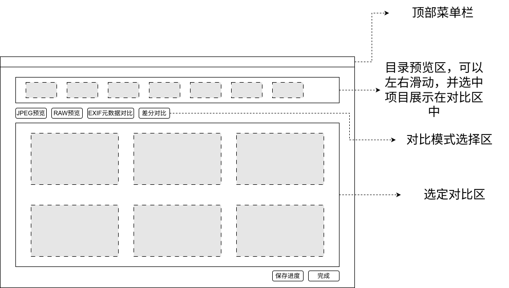
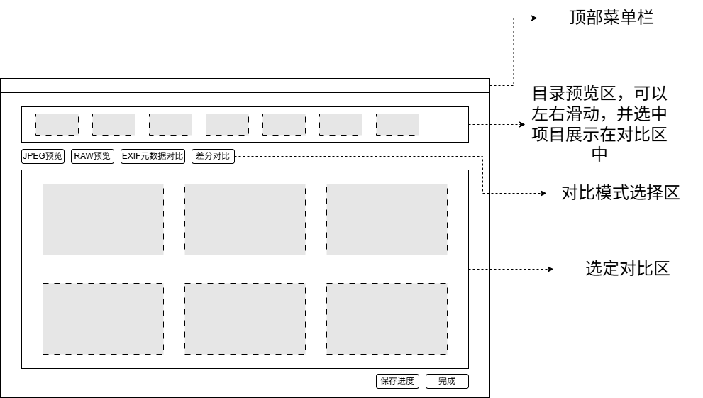

# WulingFilmPicking
接下来我们需要开发一个用于筛选照片的应用。应用主要包含如下特性：
1. 桌面端GUI应用，支持跨平台。目前计划使用Avalonia实现，如果有其他更合适的技术栈也可以讨论。
2. 基本的工作流程：选定目录 - 展示目录的所有照片的快速预览 - 选定部分照片展示在对比区 - 标记为选中/废弃 -（处理完所有照片后）提交完成 - 对标记照片进行指定处理
3. 对于选中照片、废弃照片和未标记照片，都可以选择多种处理选项，包括移动到指定目录、删除、不做处理。
4. 界面原型草图如下所示（含svg版本和png版本）：
> 
> 
5. 支持同目录下RAW格式和直出JPEG的同名自动匹配。
6. 对比区可以选择多种模式对1-9张图进行对比展示，包括JPEG预览、RAW图预览、EXIF元数据展示、色彩曲线预览等。
7. 对比区的展示模式做成可拓展的插件接口，同时内置Python运行引擎，支持Python插件和C#原生插件。
8. 基于上述插件接口，对比区功能模式可以分批实现。

---
首先完成初步设计，包括原型设计、架构设计和功能设计。
---
## 初步设计产出 (2026-10-18)

设计文档位于 [docs/design/](./design/README.md):

| 文档 | 内容 |
| --- | --- |
| [design/README.md](./design/README.md) | 总览、关键决策记录 (ADR)、里程碑 |
| [design/01-prototype.md](./01-prototype.md) | 原型设计: 布局规格、交互流程、快捷键、视觉规范 |
| [design/02-architecture.md](./02-architecture.md) | 架构设计: 技术栈、解决方案结构、领域模型、缓存/并发、提交管道 |
| [design/03-features.md](./03-features.md) | 功能设计: F1-F8 功能规格与非功能指标 |
| [design/04-plugin-system.md](./04-plugin-system.md) | 插件系统: 插件契约、C#/Python 双通道、Python 引擎与 RPC 协议 |

关键结论: 采用 **Avalonia 11 + .NET 8 (MVVM)**;RAW 采用**内嵌预览提取**策略;Python 插件走**进程外常驻 Worker + JSON-RPC**;删除默认**软删除可还原**。