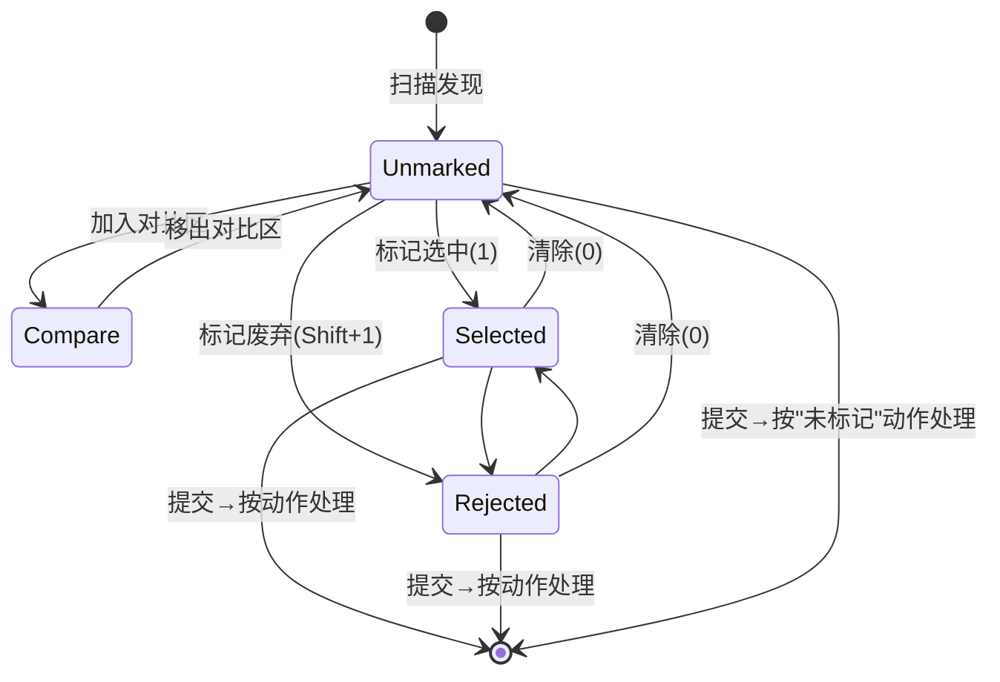

# 01 — 原型设计 (Prototype)

> 对应需求 TODO.md #2 #4 #6;草图源文件: [../ui_sketch.svg](../ui_sketch.svg)

## 1. 总体布局

单窗口、三行结构(菜单栏 / 主体 / 状态栏),主体为"上下双区"布局: 上方横向缩略图浏览条,下方为对比工作区。窗口默认 1440×900,最小 1120×720。

```
┌──────────────────────────────────────────────────────────────────┐
│ ☰ 文件(F)  标记(M)  视图(V)  帮助(H)                    [菜单栏]  │
├──────────────────────────────────────────────────────────────────┤
│  ▣ ▣ ▣ ▣ ▣ ▣ ▣ ▣ ▣ ▣ ▣ …            [目录预览区: 横向缩略图条]   │
├──────────────────────────────────────────────────────────────────┤
│ [JPEG预览] [RAW预览] [EXIF元数据对比] [差分对比] [▾ 插件…]  槽位:3 │
│ ┌──────────┐ ┌──────────┐ ┌──────────┐                           │
│ │          │ │          │ │          │      [选定对比区:          │
│ │  槽位 1  │ │  槽位 2  │ │  槽位 3  │       1-9 宫格, 模式渲染]  │
│ │          │ │          │ │          │                           │
│ └──────────┘ └──────────┘ └──────────┘                           │
│ …(最多 3×3 = 9 格)                                               │
├──────────────────────────────────────────────────────────────────┤
│ 状态栏: 目录路径 ｜ 128 张 (✅12 🗑3 ⬜113) ｜ 缩略图缓存 86%  …   │
│                                          [⚙ 处理设置] [保存进度] [完成] │
└──────────────────────────────────────────────────────────────────┘
```

与草图的对应关系: 草图四个标注 = 菜单栏 / 目录预览区 / 对比模式选择区 / 选定对比区;草图右下"保存进度""完成"按钮在实现中放入右下角命令条,并增设"⚙ 处理设置"入口(配置 F3 提交动作)。状态栏为原型细化新增。

## 2. 区域规格

### 2.1 目录预览区 (PhotoStrip)

| 项 | 规格 |
| --- | --- |
| 布局 | 横向 `ItemsControl` + `VirtualizingStackPanel`(水平),滚动条在条底部;支持鼠标滚轮(纵向滚动映射为横向)、Shift+滚轮、触摸板双指、拖拽水平滚动、拖到窗口边缘自动滚 |
| 卡片尺寸 | 缩略图统一 96×96 显示区域(内容 `UniformToFill`),卡片 120×132 含标签;`Ctrl+滚轮` 在 64~256px 间缩放 |
| 卡片元素 | ① 缩略图 ② 右上角状态角标(⬜无 / ✅选中-绿 / 🗑废弃-红) ③ 底部文件名(超长截断中段) ④ RAW+JPEG 对时显示 "RAW⇄JPG" 小徽标 ⑤ 加入对比区后显示槽位序号徽标(1-9,蓝色圆点) |
| 选中态 | 单击=加入/移出对比区;再次单击已入槽卡片=移出并压缩槽位;双击=放大预览浮层(可比对 EXIF) |
| 排序 | 文件名自然排序(数字感知),可切换按拍摄时间 |
| 过滤 | 顶部过滤按钮组: 全部 / 未标记 / 选中 / 废弃;计数显示在状态栏 |
| 无限滚动 | 虚拟化 + 分页异步解码(见 02 文档 §7),保证万级文件流畅 |

### 2.2 对比模式选择区 (ModeBar)

| 项 | 规格 |
| --- | --- |
| 形态 | 水平 `ToggleGroup`(单选),内置 4 个模式按钮 + 分隔线 + "插件"溢出下拉(≥5 个插件时折叠) |
| 内置项 | `JPEG预览` `RAW预览` `EXIF元数据对比` `差分对比`(曲线/直方图并入 EXIF 与差分面板,见 03 文档 F6/F7) |
| 每按钮 | 图标 + 文本;右侧 `槽位: N` 数字调节器(1-9)或 1×1/1×2/2×2/2×3/3×3 布局选择器 |
| 状态 | 模式与槽位数量持久化在会话中;切换模式不丢槽位内容 |
| 权限 | 模式声明的 `MinSlots/MaxSlots` 不匹配当前槽位数时按钮禁用并提示 |

### 2.3 选定对比区 (CompareGrid)

| 项 | 规格 |
| --- | --- |
| 布局 | `UniformGrid`: 槽位数 1-9,自动 1×1 / 1×2 / 1×3 / 2×2 / 2×3 / 2×4+1(广告位) → 3×3;每槽等分,窗口过窄时允许横向滚动 |
| 槽位结构 | 图片画布(模式渲染内容) + 底部信息条(文件名、当前模式摘要如 "f/4 1/250 ISO400") + 右上角操作簇: [✅][🗑][✕] |
| 渲染 | 对比区渲染完全委托给当前模式的插件视图(见 04 文档);切换槽位内容/模式时显示骨架屏加载态 |
| 拖放 | 浏览条卡片可拖入槽位;槽位间可互相拖动交换 |
| 空态 | 空槽显示虚线框 + "从上方目录拖入或单击缩略图" |
| 快捷标记 | 键盘 `1`-`9` 将对应槽位标记为选中,`Shift+1`-`9` 标记为废弃,`0` 清除当前焦点槽 |

### 2.4 命令条与状态栏

| 元素 | 行为 |
| --- | --- |
| ⚙ 处理设置 | 弹出对话框: 分别为 ✅选中 / 🗑废弃 / ⬜未标记 配置动作(移动到目录… / 删除 / 不做处理),见 03 F8 |
| 保存进度 | 立即写入会话(通常自动保存已覆盖);成功后按钮短暂显示 "已保存 HH:mm:ss" |
| 完成 | 打开"提交确认"对话框: 汇总各标记数量与将执行的动作,红色警示不可逆项,确认后进入"处理中"进度模态,结束后显示结果报告(成功/失败清单) |
| 结果报告 | 显示成功/失败/跳过清单(失败可重试);底部两枚收尾按钮(默认折叠于"更多收尾…"内): **① 归档会话**(默认动作,会话改名 `session.completed-{ts}.json` 并保留 `.wuling` 其余内容) **② 清理 .wuling…**(两级,见下);清理完成后结果报告内嵌状态行变为"已清理",目录面板刷新 |
| 清理 .wuling(两级) | **仅清缓存**: 删除 `cache/`(含缩略图与 plugin_io),保留 `session.json`/`commit-log.jsonl`/`trash/` → 进度与还原能力不丢;<br>**整目录删除**: 删除整个 `.wuling/`,**包含 `trash/` 中软删除的照片 = 永久销毁,还原能力失效** — 需确认对话框中键入 `DELETE` 且红字列出受影响项(会话进度、事务日志、回收站 N 张、还原清单);执行前再次校验引用计数归零 |
| 状态栏 | 目录路径(可点击打开文件管理器) / 总数与三色计数 / 过滤条件 / 缩略图缓存命中 / Python 引擎状态点(绿=运行 灰=未启用) |

### 2.5 顶部菜单栏

- **文件**: 打开目录…、最近目录(≥10)、保存进度、完成并处理…、刷新、退出
- **标记**: 标记选中(1)、标记废弃(2)、清除标记(0)、清除全部标记…、从对比区移除
- **视图**: 对比模式(级联列出插件)、槽位布局、缩略图大小、过滤、排序、放大预览
- **帮助**: 快捷键表、关于

## 3. 关键交互流程

### 3.1 主工作流 (选片)

```mermaid
sequenceDiagram
    participant U as 用户
    participant Strip as 目录预览区
    participant Grid as 对比区
    participant S as 会话(自动保存)

    U->>Strip: 打开目录, 浏览缩略图
    U->>Strip: 单击多张 → 进入对比区槽位
    U->>Grid: 切换模式 (JPEG/RAW/EXIF/差分/插件)
    U->>Grid: 快捷键 1-9 / Shift+1-9 标记
    Grid-->>S: 标记变更 → 防抖 1s 自动保存
    Note over Strip: 已标记卡片角标即时更新;过滤"未标记"快速收敛
    U->>U: 处理完所有照片(未标记=0 或主动放弃)
    U->>Grid: 点击 [完成] → 确认摘要 → 批量执行
    S-->>U: 结果报告(归档 / 可选清理 .wuling)
```

### 3.2 状态机: 单张照片生命周期



### 3.3 键盘快捷键总表

| 键 | 动作 | 键 | 动作 |
| --- | --- | --- | --- |
| `Ctrl+O` | 打开目录 | `1`-`9` | 对应槽位标记选中 |
| `Ctrl+S` | 保存进度 | `Shift+1`-`9` | 对应槽位标记废弃 |
| `Ctrl+Enter` | 完成(提交) | `0` | 清除焦点槽标记 |
| `←`/`→` | 浏览条光标移动 | `Space` | 焦点槽切换 JPEG/RAW 预览 |
| `Enter` | 将光标照片加入对比区 | `F` | 循环过滤(全部/未标记/选中/废弃) |
| `Tab` | 焦点在浏览条与对比区间切换 | `Esc` | 关闭浮层/取消拖放 |
| `Ctrl+滚轮` | 缩略图大小 | `F1` | 快捷键帮助 |

## 4. 视觉与体验规范

- **主题**: 跟随系统浅色/深色,基于 Avalonia `FluentTheme`;强调色 = 品牌绿 `#3A7D44`(选中),警示红 `#C0392B`(废弃),中性蓝 `#2D6CDF`(槽位序号)。
- **卡片角标**: 使用色彩+图标双通道(色弱友好),不单靠颜色传达状态。
- **字体**: UI 用系统默认(Segoe UI / PingFang SC / Noto Sans CJK);文件名、EXIF 用等宽字体(SF Mono / Cascadia)。
- **空状态与错误**: 每个区域都有插画式空态文案;IO 错误以行内警示条而非弹窗呈现,可重试。
- **暗色下图片观感**: 对比区背景 `#1E1E1E`,避免图片过暗导致误判;提供背景亮度切换。
- **无障碍**: 全键盘可达;控件带 `AutomationProperties.Name`;高对比度主题跟随系统。
- **本地化**: 全部文案经资源文件(zh-CN 为默认,resx 架构预留 en-US)。
- **窗口记忆**: 记住窗口大小/位置/分栏比例/模式/槽位数(存会话)。
