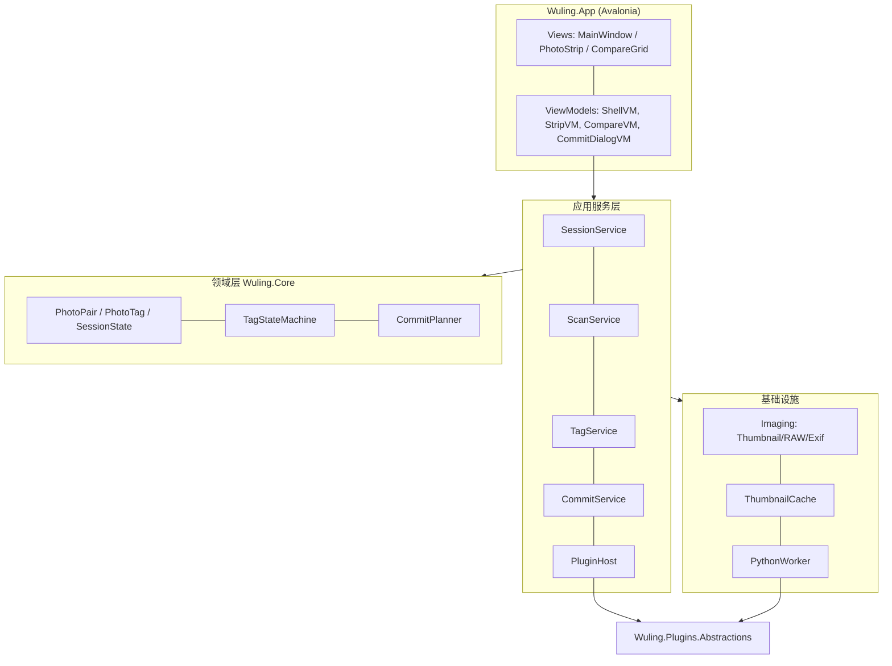
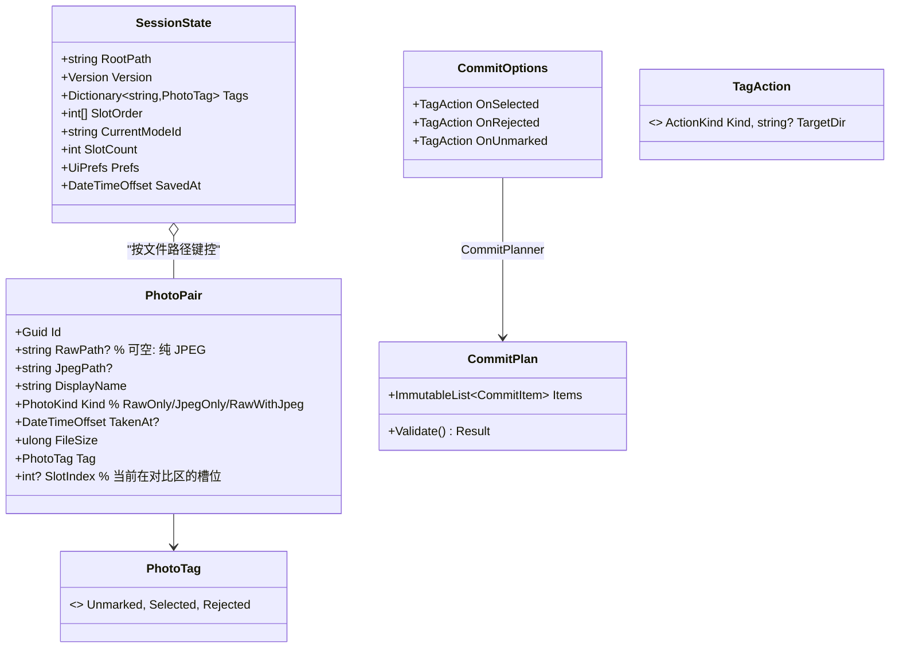
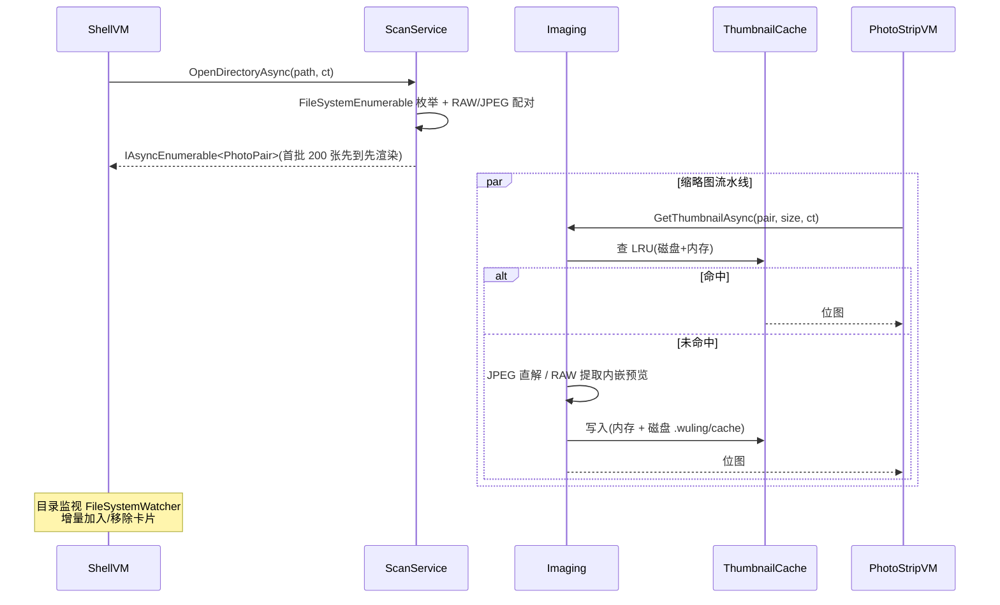
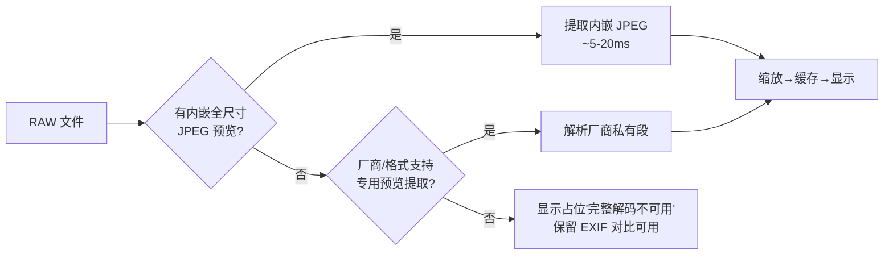
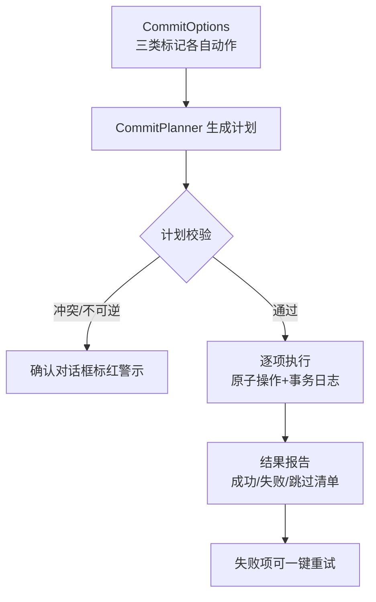

# 02 — 架构设计 (Architecture)

> 对应需求 TODO.md #1 #2 #3 #5 #7;决策记录见 [README.md](./README.md)

## 1. 技术栈总览

| 层 | 选型 | 版本 | 说明 |
| --- | --- | --- | --- |
| UI 框架 | Avalonia | 11.x | 跨平台 Win/macOS/Linux,Skia 渲染 |
| UI 模式 | MVVM + CommunityToolkit.Mvvm | 8.x | 源生成器 `[ObservableProperty]`/`[RelayCommand]` |
| DI / 日志 | Microsoft.Extensions.* (GenericHost) | 8.x | DI、配置、`ILogger` |
| RAW 解码 | 内嵌预览提取(自研) → LibRaw 绑定(后期) | — | 见 §6 RAW 策略 |
| 元数据 | MetadataExtractor | 2.8.x | 纯托管,覆盖 JPEG/各厂 RAW 的 MakerNote 关键项 |
| EXIF 兜底 | ExifTool(外部进程,可选安装) | — | 冷门机身/镜头名兜底 |
| 图像绘制(曲线/直方图) | SkiaSharp | 2.88.x | 与 Avalonia 同管线,绘制轻量图表 |
| Python 引擎 | 常驻 Worker 进程 + JSON-RPC over stdio | Python ≥3.9 | 见 04 文档 §4;`pythonnet` 方案被否(嵌入 GIL/版本绑定问题) |
| 测试 | xUnit + Avalonia.Headless | — | Headless 跑 VM 与部分视图测试 |
| 打包 | Win: Inno/MSIX;macOS: dmg( ad-hoc 签名起步);Linux: AppImage/deb | — | M4 交付 |

**.NET 版本**: .NET 8 LTS,`net8.0` + Avalonia 全平台 TFM;文件 IO 全部用 `System.IO` 抽象,路径用 `Path`/`Uri` 组合,避免 Windows 专属 API。

## 2. 解决方案结构

```
WulingFilmPicking.sln
├─ src/
│  ├─ Wuling.Core/            # 领域与业务(无 UI 依赖)
│  │  ├─ Models/              # PhotoPair, PhotoTag, SessionState, CommitPlan…
│  │  ├─ Scanning/            # 目录扫描、RAW/JPEG 同名配对
│  │  ├─ Tagging/             # 标记状态机
│  │  ├─ Sessions/            # 会话持久化
│  │  └─ Commit/              # 提交计划与动作执行(移动/删除/回收站)
│  ├─ Wuling.Imaging/         # 图像管道: 缩略图、RAW 预览提取、EXIF、直方图
│  ├─ Wuling.Plugins.Abstractions/  # 对比模式插件契约(独立包,稳定 API)
│  ├─ Wuling.Plugins.BuiltIn/ # 内置模式: JPEG/RAW/EXIF/差分(吃自己狗粮)
│  ├─ Wuling.Plugins.Python/  # Python 引擎宿主(Worker 管理 + RPC)
│  ├─ Wuling.App/             # Avalonia 桌面应用(Shell、VM、视图)
│  └─ Wuling.Cli/             # (可选) 无 GUI 提交/批处理入口,便于脚本化
├─ plugins/                   # 随应用分发的 Python 插件(源码形态)
│  └─ builtin/exif_panel/…
├─ tests/
│  ├─ Wuling.Core.Tests/
│  ├─ Wuling.Imaging.Tests/   # 用 docs/test-fixtures 生成的小样本图
│  └─ Wuling.App.Tests/       # Headless VM/交互测试
├─ docs/                      # 设计文档(本目录)
└─ .wuling/                   # 运行时工作目录约定(会话/缓存/回收站)
```

**依赖方向**: `App → Plugins.BuiltIn/Python → Abstractions → Core/Imaging`;`Abstractions` 不引用 UI 程序集,但定义 `Control CreateView()` 时通过 `dynamic`/延迟绑定实现(见 04 §2),保证插件包可独立编译。

## 3. 分层架构



- **ViewModel 不碰 `System.IO`**: 全部经注入的 `IScanService`/`ISessionService` 等,便于 Headless 测试。
- **领域模型为纯 POCO + 显式状态机**,标记合法性由 `TagStateMachine` 集中校验(见 03 F4)。

## 4. 核心领域模型



- **配对键**: 同目录、同主文件名(大小写不敏感、忽略 `dng` 与 `jpg/jpeg` 后缀差异),如 `IMG_1234.CR2 ⇄ IMG_1234.JPG`。以 RAW 为"正身",JPEG 为附属预览源。
- **会话按路径键控存储标记**,扫描后按路径重放,保证目录增删照片后进度仍能恢复(03 F5)。

## 5. 应用服务与数据流



**线程模型**:
- UI 线程只做绑定与渲染;扫描、解码、EXIF 均在 `Task.Run` 池线程;SkiaSharp 位图跨线程只传像素句柄,在 UI 线程包装为 `WriteableBitmap`。
- 所有长任务支持取消(`OpenDirectoryAsync` 中再次打开目录会取消上一次)。
- 全局并发闸门: 缩略图解码 `SemaphoreSlim(ThrottleOptions)`,默认 `CPU 核数`,避免万张图打爆内存。

## 6. RAW 显示策略(分层降级)



- **首选**: 按格式读取 RAW 内嵌预览(`IFD0`/`SubIFD` 预览 IFD 或厂商段),覆盖 CR2/CR3/NEF/NRW/ARW/RAF/ORF/RW2/DNG/PEF 的绝大多数场景 —— 选片不需要 100% 像素级画质。
- **M4+ 增强**: `LibRaw` P/Invoke 全解码(真·RAW 渲染、白平衡可调),作为可选扩展点 `IRawDecoder` 注册,默认实现为内嵌提取器。
- **DNG 特例**: 若包含 `EmbeddedFastThumbnail`/`PreviewImage` 直接使用;未渲染 DNG(`LinearRaw`)按无内嵌处理。

### 6.1 格式支持矩阵(M2 验收基准)

| 格式 | 提取方式 | 内嵌预览情况 | 已知注意点 |
| --- | --- | --- | --- |
| CR2 | TIFF IFD Preview 条目 | 全尺寸 JPEG,覆盖好 | 无 |
| CR3 | CRX 盒结构内预览轨 | 全尺寸 JPEG,覆盖好 | 需按盒偏移定位,非标准 TIFF |
| NEF / NRW | IFD Preview 条目 | 全尺寸 JPEG,覆盖好 | 少数老机型仅缩略图 |
| ARW | IFD Preview 条目 | 全尺寸 JPEG,覆盖好 | 无 |
| **RAF** | **RAF 头部偏移字段直取** | 多数机型全尺寸高质量 JPEG | 头内同时含 ~160px 缩略图与全尺寸预览,**必须取较大者**;极早期机型预览偏小 |
| ORF | IFD Preview 条目 | 全尺寸 JPEG,覆盖好 | 无 |
| **RW2** | **TIFF 变体(松下)IFD Preview 条目** | 现代 Lumix 多为全尺寸 JPEG | 老款 G 系列可能仅 ~1/4 尺寸预览 → 可用但偏糊;无预览文件走占位 + ExifTool 兜底 |
| DNG | `EmbeddedFastThumbnail`/`PreviewImage` | 视写入方 | 未渲染 DNG(`LinearRaw`)按无内嵌处理 |
| PEF | IFD Preview 条目 | 多数有 | 低端机型覆盖一般 |
| SRW / X3F | IFD / X3F 私有结构 | 三星/适马覆盖一般 | X3F 无内嵌时显示占位(Foveon 用户后期接 LibRaw) |

> RAF 与 RW2 在 M2 抽样测试中为**必测格式**(含新型号与老型号各 ≥1 台的样本),样例纳入 `docs/test-fixtures`。

## 7. 缩略图与缓存

| 层 | 实现 | 参数 |
| --- | --- | --- |
| 内存 LRU | `MemoryCache` 定制 LRU,按字节计量 | 默认 256MB,设置可调 |
| 磁盘缓存 | `.wuling/cache/thumbs/{hash}.jpg`,`hash = sha1(path|mtime|size|edge)` | 容量上限 1GB,LRU 清理;缓存目录可迁移 |
| 解码节流 | 全局 `SemaphoreSlim` + 请求合并(同图同时只解一次) | 并发 = CPU 核数 |
| 失效 | mtime/size 变化即失效;会话打开时后台清理孤儿缓存 | — |

大目录性能目标: 10,000 张目录首屏(前 200 张)可交互 < 3s(命中缓存 < 500ms);滚动时按需解码,掉帧 < 5%。

## 8. 提交处理(Commit)管道



- **动作原语**: `Move(dir)` / `Delete` / `RecycleBin`(仅 Win;mac/Linux 折叠为软删除) / `None`。
- **软删除**: 先移入 `.wuling/trash/{yyyyMMdd-HHmmss}/`(同结构保留相对路径)并生成 `manifest.json`(原路径、时间),支持"还原上次提交";跨卷移动 = copy→fsync→delete→校验哈希。
- **冲突处理**: 目标同名 → 默认 `name (2).ext` 递增;可在设置改"覆盖/跳过/递增"。
- **事务日志**: `.wuling/commit-log.jsonl` 逐条记录已执行操作,崩溃后可续跑或回滚未完成项。
- **安全阀**: 单次提交删除 > 50% 且 > 100 张时,要求输入框确认;RAW+JPEG 对默认绑定处理(拆散需显式开关)。

## 9. 会话持久化与目录约定

```
<照片目录>/.wuling/
├─ session.json          # 标记、槽位、模式、UI 偏好(原子写: tmp+rename)
├─ session.lock          # 打开目录即持锁;第二实例打开同目录→只读模式提示
├─ commit-log.jsonl
├─ cache/thumbs/
└─ trash/{timestamp}/
```

- 只读目录(无写权限)时回退 `AppData/Wuling/sessions/{root-hash}/session.json`,状态栏提示。
- 自动保存: 标记/槽位变更防抖 1s;每 30s 兜底;`Ctrl+S` 立即。
- `session.json` 带 `Version` 字段,升级向后兼容(未知字段忽略)。

## 10. 错误处理与日志

- 分级: 可重试 IO(重试 3 次退避) / 单项失败(降级为占位并聚合到状态栏) / 致命(对话框 + 日志)。
- 日志: `Serilog` 滚动文件 `AppData/Wuling/logs/wuling-.log`,保留 7 天;崩溃时引导用户附日志反馈。
- 全局异常兜底: `TaskScheduler.UnobservedTaskException` + Avalonia `DispatcherUnhandledException` → 错误窗口(附导出日志按钮)。

## 11. 里程碑

| 里程碑 | 范围 | 出口标准 |
| --- | --- | --- |
| **M0 骨架** | 解决方案 + Shell + 打开目录 + JPEG 缩略图浏览条 | 万级目录浏览流畅;Headless 测试绿 |
| **M1 核心选片** | 对比区(1-9 槽) + 标记 + 会话保存/恢复 + 提交处理 | 完整闭环: 选片→标记→提交→移动/删除生效 |
| **M2 RAW 与元数据** | RAW 内嵌预览 + EXIF 对比 + 直方图/曲线 | CR2/CR3/NEF/ARW/DNG 抽样机型可用 |
| **M3 插件系统** | 契约 + C# 加载器 + Python 引擎 + 差分对比插件 | 双语言宿主加载/渲染/卸载可运行 |
| **M4 打磨** | 回收站/还原、递归扫描开关、i18n、安装包 | 三平台安装包 + 冒烟矩阵通过 |

## 12. 风险与对策

| 风险 | 影响 | 对策 |
| --- | --- | --- |
| 冷门 RAW 无内嵌预览 | 对比区黑块 | 占位提示 + ExifTool 兜底提取 + 后期 LibRaw |
| 万级目录扫描卡 UI | 体验劣化 | `IAsyncEnumerable` 分批渲染 + 虚拟化 + 节流(§5/§7) |
| Python 环境碎片化 | 插件不可用 | 引擎声明最低版本;插件元数据声明依赖;启动自检并引导安装;Worker 崩溃自动重启(04 §4) |
| 误删照片 | 数据事故 | 默认软删除 + 事务日志 + 还原(§8);危险操作二次确认 |
| Avalonia 平台差异(菜单/文件对话框) | 平台怪癖 | 抽象 `IPlatformDialog` 服务,逐平台适配测试 |
| 大图(>100MP)内存峰值 | OOM | 流式解码 + 边缘缩略图先行 + 全尺寸按需加载与及时释放 |
