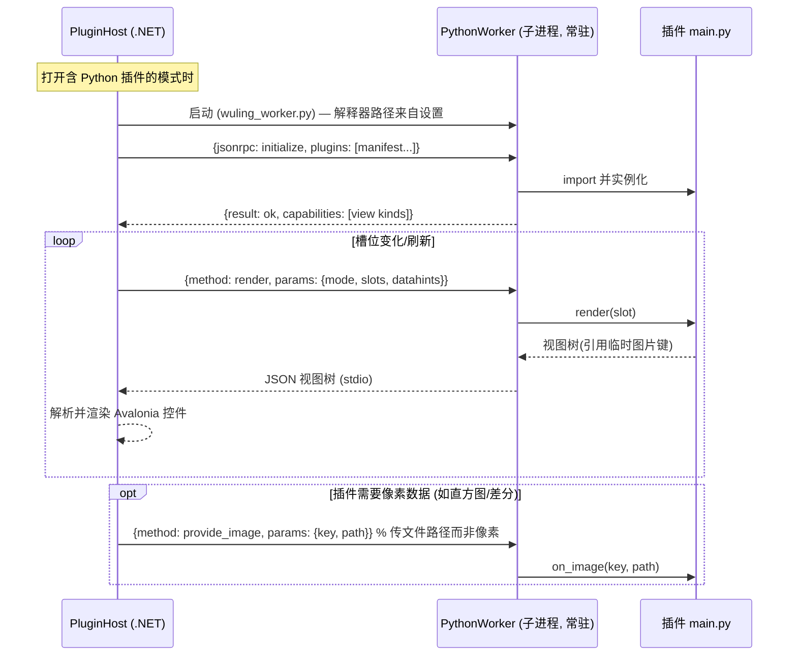
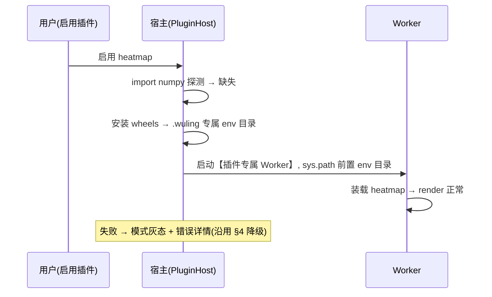
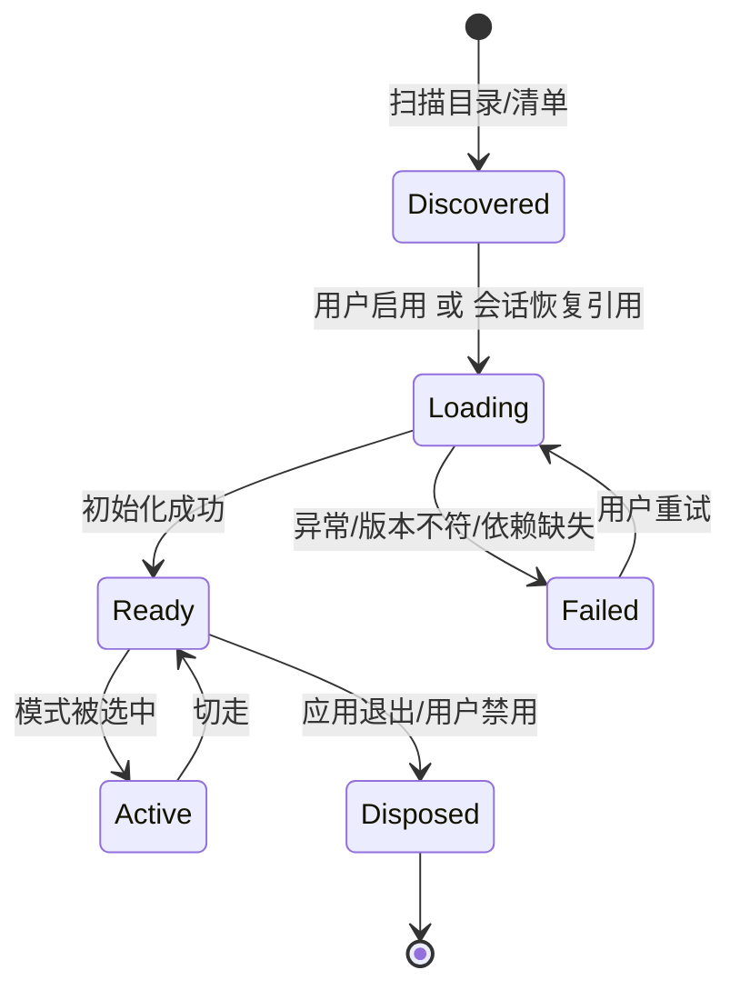

# 04 — 插件系统设计 (Compare-Mode Plugin System)

> 对应需求 TODO.md #6 #7 #8;内置模式与第三方插件共用同一契约(ADR D8)。

## 1. 设计目标

1. **一个契约,两种语言**: C# 原生插件与 Python 插件实现相同的对比模式语义。
2. **稳定内核**: 契约程序集(`Wuling.Plugins.Abstractions`)独立版本化,向后兼容承诺 ≥ 1 个大版本。
3. **崩溃隔离**: Python 插件崩溃不影响宿主;C# 插件失败降级为禁用。
4. **数据可达**: 插件可拿到文件路径、已解码的缩略图/预览位图、EXIF、直方图等公共数据服务。

## 2. 插件契约(C# 侧)

```csharp
namespace Wuling.Plugins.Abstractions;

/// <summary>对比模式插件。实例在模式首次激活时创建,随模式切换释放。</summary>
public interface ICompareModePlugin
{
    CompareModeDescriptor Descriptor { get; }

    /// <summary>创建该模式的根视图。UI 细节由插件自行决定(自定义 Control 或组合内置控件)。</summary>
    object CreateView(ICompareContext context);

    ValueTask InitializeAsync(IPluginServices services, CancellationToken ct);
    ValueTask DisposeAsync();
}

/// <summary>模式描述与能力声明。</summary>
public sealed record CompareModeDescriptor(
    string Id,                    // 全局唯一, 如 "builtin.exif", "py.grade-curve"
    string Title,                 // 已本地化
    string? IconKey,
    int MinSlots, int MaxSlots,   // 1-9
    PluginKind Kind);             // CSharp / Python

/// <summary>宿主注入的公共数据服务(全部纯数据, 无 UI)。</summary>
public interface IPluginServices
{
    IPhotoSource Photos { get; }             // 槽位中的 PhotoPair
    IExifProvider Exif { get; }              // EXIF 读取(带缓存)
    IImageSource Images { get; }             // 预览/全尺寸解码(带缓存)
    IHistogramSource Histograms { get; }     // 直方图/曲线计算(带缓存)
    ILogger Logger { get; }
    IPluginStorage Storage { get; }          // 插件私有配置 (json)
}

/// <summary>模式视图的上下文: 当前槽位与变更通知。</summary>
public interface ICompareContext : INotifyPropertyChanged
{
    IReadOnlyList<PhotoPair?> Slots { get; } // null = 空槽
    int SlotCount { get; }
    CompareModeHost Host { get; }            // 摘要行、加载态、错误呈现
}
```

**加载与解析**:

| 阶段 | C# 插件 | Python 插件 |
| --- | --- | --- |
| 发现 | 扫描 `plugins/dotnet/*.dll` 与插件目录清单 | 扫描 `plugins/python/*/plugin.json` |
| 元数据 | 程序集特性 `[WulingPlugin(id, title, minSlots, maxSlots)]` | `plugin.json`(id/title/slots/entry) |
| 加载 | 独立 `AssemblyLoadContext`(可卸载,collectible) | 子进程 Worker 装载 |
| 实例化 | 反射查找 `ICompareModePlugin` 实现 | RPC `initialize(descriptor)` |
| 失败处理 | 加载异常→禁用+日志,不阻塞其他插件 | Worker 启动失败→灰态+重试按钮 |

**版本协商**: 宿主声明 `AbstractionsVersion`;C# 插件程序集特性标注 `MinHostVersion`,不满足则禁用;Python `plugin.json` 标注 `api: 1`,宿主只加载 `api: 1`。

**UI 渲染通道**: `CreateView` 返回 `object`。
- C# 插件: 返回 Avalonia `Control`。为避免 Abstractions 直接依赖 Avalonia,宿主侧用 `dynamic` 适配(Abstractions 只承诺 `object`),并提供 `Wuling.Plugins.Avalonia` 辅助包给想要强类型的插件作者。
- Python 插件: 返回宿主提供的 `PythonPluginView`,其内容是**声明式布局**(见 §3)或**自绘位图**(见 §4),不是任意 Python 控件 —— 保证安全边界。

## 3. Python 插件模型

Python 插件不做任意 UI,而是向宿主**声明**视图,由宿主渲染,插件只算数据:

```jsonc
// plugins/python/my-mode/plugin.json
{
  "api": 1,
  "id": "py.my-mode",
  "title": "我的对比模式",
  "icon": "sparkles",
  "minSlots": 2, "maxSlots": 9,
  "entry": "main:WulingPlugin",        // 模块:类
  "python": ">=3.9",
  "deps": ["numpy>=1.24"]              // 由宿主在引导时检查/提示
}
```

```python
# main.py
from wuling_sdk import PluginBase, plugin

@plugin  # 读取 plugin.json 元数据注册
class WulingPlugin(PluginBase):
    def render(self, slot):                     # 每槽返回声明式视图树
        ex = self.services.exif(slot.pair)
        return {"kind": "stack", "children": [
            {"kind": "image", "src": slot.pair.preview, "fit": "contain"},
            {"kind": "table", "rows": [["镜头", ex.lens], ["ISO", ex.iso]]},
        ]}

    def on_action(self, action, payload):        # 宿主回调(刷新/参数变化)
        if action == "refresh":
            return self.render_all()
```

**声明式视图元素(首版)**: `image / text / table / kv / histogram / curve / stack / row / grid`。宿主将树映射到内置 Avalonia 控件;未知 `kind` 渲染为占位并告警(向前兼容)。

### 3.1 数据交互模型: 引用传递,而非像素数组

插件与宿主之间的数据流分三个方向:

| 方向 | 载体 | 内容 |
| --- | --- | --- |
| 宿主 → 插件 (数据服务) | `IPluginServices` (C#) / `wuling_sdk` 代理 (Python) | 文件路径、`PhotoPair` 元数据、EXIF(带缓存)、解码图像的**缓存键/路径**、直方图服务 |
| 宿主 → 插件 (上下文) | `ICompareContext` | 当前槽位列表、槽位数、变更通知(属性事件) |
| 插件 → 宿主 (渲染) | C#: Avalonia `Control` 对象<br>Python: **声明式视图树 (JSON)** | 视图结构 + 对宿主资源的**引用**, 不含数据本体 |

**图片渲染三条通道**(按成本从低到高):

| 通道 | 机制 | 适用场景 |
| --- | --- | --- |
| ① 引用宿主缓存 (零拷贝) | 视图树 `{"kind":"image","src":<缓存键>}`,或 C# 中 `IImageSource.GetPreview()` 返回宿主缓存位图的**对象引用**;插件全程不触碰像素 | 展示原始/预览图(绝大多数场景) |
| ② 文件路径交换 | 宿主把解码预览落盘 `.wuling/cache/plugin_io/{key}.jpg` → `provide_image(key, path)`;插件用 PIL/numpy 读文件做逐像素处理,结果写回临时文件,视图树引用结果路径;宿主渲染后按会话清理 | 插件需要像素级运算(差分/合成/标注) |
| ③ 小数组直接传 | 直方图(256 bin × 3 通道 ≈ 3KB)、曲线控制点等**聚合后的小数值数组**,直接内联进视图树 JSON | 统计类数据,不含原始像素 |

**硬性规则**: 原始像素数组**永不**跨越插件边界传输。依据: 一张 24MP 图的 RGBA 数组 ≈ 96MB,序列化与复制均不可接受;宿主缓存体系(02 文档 §7)已持有解码位图,插件再要一份像素属于内存翻倍 + 缓存旁路;stdio JSON-RPC 仅承载文本消息,二进制一律走文件系统(§4)。

**性能含义**: 通道①下 Python 插件显示一张图与内置模式成本相同(命中宿主缓存);通道②的单次像素处理成本 ≈ 两次文件读写 + 插件计算,适合低频刷新(槽位/参数变化),不适合高频动画 —— 若未来出现高频需求,预留 `shared_memory` 传输类型作为演进方向,首版不实现。

### 3.2 plugin_io 文件的生命周期

**核心原则**: `plugin_io/` 下所有文件都是**可再生缓存** —— 任何时刻删除都不影响正确性,清理策略只负责磁盘占用,不需要精确追踪"最后使用"。

**键方案(内容寻址)**:

- 宿主输入: `input_key = sha1(照片路径|mtime|size|解码边长)`,与缩略图缓存(02 §7)同构,跨会话可复用
- 插件输出: `output_key = sha1(input_key|插件id|插件版本|参数哈希)`,同参数重渲染零成本
- 视图树中的 `src` 即这些键;键 → 实际路径的解析由 PluginHost 统一负责

**清理时机**:

| 时机 | 动作 | 理由 |
| --- | --- | --- |
| 槽位/参数变化 | **不立即删除** | 内容寻址使同 key 结果可复用,来回切槽位不重算 |
| 视图替换/模式切走 | 引用计数 −1,归零仅标记"可回收" | 文件可能马上又被引用 |
| 容量超限 | 后台 LRU 逐出(默认上限 512MB,设置可调) | **引用计数 > 0 的文件永不逐出**(正在显示的图不能消失) |
| 会话关闭/应用退出 | 删除 `deterministic: false` 插件的输出;其余留存为缓存 | 见下"非确定性插件" |
| 目录打开时 | 对账清扫: 孤儿文件清理 + 超限 LRU 逐出 | 兜底 |
| 宿主崩溃后 | 内存引用计数表丢失 → 下次打开的对账清扫恢复一致 | 崩溃安全: 文件可再生,无"删不掉"或"误删仍在显示"状态 |

**非确定性插件**: 默认(可缓存)插件必须保证"同输入 + 同参数 → 同输出";plugin.json 可声明 `"deterministic": false`(如含随机采样、依赖当前时间),此类插件的输出走会话级临时目录,**会话结束必删** —— 这是"会话结束清理"严格生效的唯一场景。

**磁盘位置**: `.wuling/cache/plugin_io/{inputs,outputs}/` 位于照片目录内;SD 卡等空间敏感场景可在设置中迁移缓存目录(沿用 02 §7 的缓存迁移约定),上限独立于缩略图缓存。

## 4. Python 引擎(进程外常驻 Worker)



**关键决策**:

| 项 | 决策 |
| --- | --- |
| 进程模型 | 常驻 Worker(每个解释器一个),插件按 manifest 装入;空闲 10 分钟后自动回收;崩溃后自动重启一次,再失败→模式禁用并提示 |
| 传输 | JSON-RPC 2.0 over stdio,每行一个消息(NDJSON);二进制不进 stdio |
| 像素/大文件 | 传**路径或缓存键**而非裸字节;宿主把解码预览落 `.wuling/cache/plugin_io/{key}.jpg`,Worker 读取后回传结果图路径;一次性会话结束由宿主清理(防泄漏) |
| 超时 | 渲染默认 3s 超时→该槽显示超时占位,Worker 不杀;累计 3 次超时→插件禁用 |
| SDK | 随应用分发 `wuling_sdk`(纯 Python,仅标准库),内含 `PluginBase`、声明式视图构造器、EXIF 代理(Worker 侧独立 `exiftool`/`pillow-heif` 可选) |
| 环境自检 | 启用时检测解释器版本 ≥3.9;`deps` 缺失→灰态+引导安装(见 §4.5),不再要求用户手动 pip |
| 安全 | 插件以用户权限运行(与主程序一致);不做沙箱,但文档明确"只安装可信来源插件";宿主限制 Worker 可访问路径清单(默认: 照片目录 + 缓存目录) |

**为什么不用 pythonnet 嵌入**: 嵌入式解释器锁定单一 Python 版本、GIL 阻塞 UI 线程互操作、平台二进制分发复杂;进程外 Worker 崩溃隔离且用户可用任意 ≥3.9 环境(conda/venv/系统)。

### 4.5 Python 运行时分发与依赖环境管理(M4)

**核心原则**: 依赖永不进主程序包 —— 主包只带"纯 stdlib 运行时";deps 归插件自己声明、自己携带(wheels),宿主只做检查、引导安装与隔离。

#### 4.5.1 解释器解析链(M4 目标形态)

```
设置中显式指定 → WULING_PYTHON 环境变量 → 内置运行时(随应用分发) → PATH → 已知安装位置
```

- M3 开发期的硬编码路径(开发机专用)在 M4 删除, 开发者用 `WULING_PYTHON` 指路。

#### 4.5.2 内置运行时选型

| 方案 | 体积 | 特点 |
| --- | --- | --- |
| **Windows embeddable package**(python.org 官方) | 下载 ~11MB, 解压 ~17MB | 官方出品、PSF 许可可再分发;默认无 pip、`python3xx._pth` 需解锁;**无法建 venv** |
| python-build-standalone(uv/ruff 生态同款) | ~30-60MB | 完整可重定位安装, pip/venv 可用, 跨平台一致 |

**决策: Windows 用 embeddable package;macOS/Linux(若做)用 python-build-standalone。**

理由: 契约已决定 `wuling_sdk` 纯标准库、Worker 协议只依赖 stdlib —— 内置 Python 只是"跑协议循环的运行时", 不需要包管理能力;~17MB 换"开箱即用"。摄影用户大概率未装 Python, 内置运行时决定 Python 插件功能对普通用户是否存在。

分发形态:

- 运行时放 `<app>/plugins/runtime/python/`, 与 Worker 脚本(`plugins/python/`)解耦;打包时均为 Content 文件, 与 .NET 自包含/单文件发布无冲突(单文件发布时 Content 仍落盘)。
- 许可: PSF license 允许再分发, 发布包内附 Python LICENSE 文本。
- 纯 stdlib 约定 = **api:1 阶段内置运行时不预装任何第三方包**。

#### 4.5.3 插件依赖分发形态: 插件 = 自包含目录

```text
plugins/python/heatmap/
├── plugin.json          # deps: ["numpy>=1.26,<3"], "python": ">=3.9"
├── main.py
├── wheels/              # 可选: 离线 wheel 包(推荐)
│   ├── numpy-2.1.3-cp312-win_amd64.whl
│   └── ...
└── README.md
```

- **带 `wheels/` 是首选**: 插件作者锁定版本随插件打包, 用户安装零网络依赖、零解析意外。分发载体是一个 zip/文件夹, 解压到 `AppData/Wuling/plugins/python/<id>/`(用户目录覆盖应用目录, 规则同 §5)。
- 平台注意: numpy 等 C 扩展 wheel 带 `cp3x-win_amd64` 平台标签, 插件作者按目标平台带齐;纯 Python 依赖不受影响。
- 未带 `wheels/` 且本机缺失依赖 → 灰态 + 提示"此插件需要自定义 Python 环境"(走 §4.5.1 解析链指向用户 venv/conda)。两条路并存。

#### 4.5.4 依赖安装与隔离



| 项 | 决策 | 理由 |
| --- | --- | --- |
| 安装目标 | `AppData/Wuling/plugin_env/<pluginId>/<depsHash>/`, **每插件独立目录** | 照片目录可能在 SD 卡上(空间敏感+拔卡消失);depsHash 使"升级插件→重建 env"自然发生 |
| 隔离粒度 | **有 deps 的插件独享一个 Worker**(sys.path 指向自己的 env);纯 stdlib 插件继续共享主 Worker | 两个插件分别要 numpy 1.x/2.x 时, 同进程 sys.path 必冲突;"每个解释器一个 Worker"是 §4 既定进程模型, 此处落到插件粒度 |
| 安装引擎 | 首选: 构建期给内置 embeddable 运行时预装 pip;或主包带 `uv.exe`(~15MB)作安装引擎(`uv pip install --target`) | embeddable 默认无 pip;uv 无需解释器即可安装, 速度快且免构建期 hack |
| 安装降级 | `pip install --target` 本质 ≈ 解包 wheel;首版可绕过 pip 直接解 wheel 到 env 目录 | 规避 embeddable 无 pip 的问题, 大部分场景等价 |

#### 4.5.5 体积与版本纪律

- 主包体积不变(numpy 永不进入);成本转移到"用到该插件的人" —— heatmap 插件 zip 带 numpy wheel ≈ +15MB, 仅安装该插件时付出。
- `plugin.json` 的 deps **必须带上限**(`numpy>=1.26,<3`): 宿主按 depsHash 缓存, 插件作者升级依赖 = 重建 env。
- numpy 2.x 对 1.x 编译的 C 扩展不兼容 —— 这是"每插件独立 env"而非共享 site 目录的硬理由。
- env 目录可再生(与 §3.2 plugin_io 同哲学): 删除即重建;卸载插件 = 删插件目录 + 对应 env。
- 实施里程碑: 随 M4 打包一起(安装引擎选型 pip-vs-uv 与打包形态绑定)。

### 4.6 渲染性能(M4 性能专题)

> 背景: M3 验收时发现 Python Hello 模式点击选片后出图慢。实测延迟链拆解 —— RPC 往返 <50ms, Worker 冷启动 200-400ms(已在打开目录时摊销), **大头是 UI 线程上的全尺寸原图解码**(24MP JPEG 单张 100-500ms, 7 槽串行, 且每次刷新零缓存重解)。

#### 4.6.1 两类插件, 两条优化路线

| 插件类型 | 图像需求 | 正确路线 |
| --- | --- | --- |
| **展示类**(预览/EXIF/直方图/Hello) | 屏上单格 ≤2048px, 4K 屏 3×3 宫格单格 ~1280px | **降采样走宿主缓存**(§3.1 通道①): `GetView(pair, 1024~2048)` 命中 LRU, 解码 20ms 级, 二次显示 0ms。这不是权宜之计, 是此类插件的终态 |
| **计算类**(差分/堆栈/对齐/AI) | 绕不开大像素 | 见 4.6.2-4.6.5: 预解码落盘 + 并行 Worker 池 + 按槽异步 + 增量跳过 |

关键认知: 对计算类插件, **宿主 C# 侧解 24MP 同样要几百 ms** —— Python 不是天然慢的一方, **解码 + 像素搬运才是**。优化重心是消灭重复解码与串行等待, 而非"让 Python 变快"。

#### 4.6.2 预解码落盘(消灭重复解码, 单项收益最大)

宿主把降采样后的 **Bgra8888 原始字节直接落盘** `.wuling/cache/plugin_io/{input_key}.raw`(内容寻址 key 已在 §3.2 定义):

- 插件读 60MB 顺序 IO ~50ms, **跳过解码**(链路中最贵的一段)
- 跨槽位/跨会话全命中缓存(可再生, 清理策略同 §3.2)
- 插件侧 numpy 可 `np.frombuffer` + `reshape` 零拷贝读入
- 宿主预解码可 4 线程并行(C# 解码是 GIL-free 的原生代码)

#### 4.6.3 并行化: Worker 池, 而非每图一进程

| 方案 | 评估 |
| --- | --- |
| 每图一个 Worker(max=9 进程) | ❌ 9 × 30-80MB 基线内存;进程冷启动 200-400ms 摊到每次渲染;管理成本失控 |
| **N = 物理核数的 Worker 池(2-4 个), 槽位任务分发** | ✅ 9 张图切分为 9 个独立任务, 尾延迟 ≈ 最慢单图而非总和;空闲回收(§4 已有 10 分钟回收设计) |
| **Worker 内线程池** | ✅ 零额外进程。numpy/PIL 重活释放 GIL, `concurrent.futures` 4 线程即真并行;纯 Python 循环退化为串行但不比现在差 |
| 宿主并行解码 + 只喂小图 | ✅ 配合项: C# 侧并行解 9 张 + 降采样, 把输入准备时间也并行掉 |

**决策: 双层并行 = N-Worker 池(2-4, 宿主按 `Environment.ProcessorCount` 与插件声明的 `parallelism` 能力协商) + Worker 内线程池。** 有 deps 的插件独享 Worker(§4.5.4)时, 该专属 Worker 同样进池化模型。

#### 4.6.4 按槽异步渲染(并行收益落到体感的前提)

当前 `render` 是整批同步 RPC: 9 槽一枪, 最慢的图拖住全部。改为:

- `render_slot(slotIndex)` 按槽请求, **哪个槽先回来哪个先上屏**(未就绪槽显示骨架占位)
- 防抖 100ms + 渲染序号防乱序(旧响应丢弃)—— 快速多选时请求堆积与覆盖问题一并解决
- 协议向后兼容: `render`(整批)保留为便捷封装, 内部拆发 `render_slot`

#### 4.6.5 增量渲染(工作量杠杆)

`render_slot` 请求携带每槽**内容 key**(路径+mtime+参数哈希, 与 §3.2 input_key 同构):

- 内容未变的槽, 插件返回 `{cached: true}` 跳过重算
- 切一张图只重算一张: 从 9 份工作降到 1 份, 是交互流畅度的最大杠杆
- Worker 侧缓存即可, 宿主不感知

#### 4.6.6 顺带修复(M3 已知问题)

| 问题 | 修法 |
| --- | --- |
| Worker stderr 无排水 → 写满 ~4KB 管道缓冲死锁(表现为 3 次超时→禁用) | 常驻 drain 任务, 内容进诊断日志与错误态 |
| WriteLoop 15ms 轮询 | `Channel<string>` + `await reader` |
| `PythonSlotView.PreviewBitmap` UI 线程同步解码、无缓存 | 后台解码 + 占位回填 + 按路径 LRU |
| Worker 冷启动 `await` 在 LoadDirectoryAsync 内 | fire-and-forget 预热, 完成后刷新 Modes |

#### 4.6.7 演进备案

高频像素需求 → `shared_memory` 传输(numpy mmap 零拷贝), 彻底消灭序列化。§3 已预留, 首版不做。

**实施顺序(M4)**: §4.6.6 观测/修复 → §4.6.4 按槽异步 → §4.6.2 预解码落盘 → §4.6.3 Worker 池 → §4.6.5 增量。每步独立可测, 第一步消掉"最慢图拖全场"的体感。

## 5. 插件发现、加载与生命周期



- 插件目录: 内置随应用 `plugins/` + 用户目录 `AppData/Wuling/plugins/`(同名以用户为准)。
- 启用/禁用与排序存于设置;会话记录当前模式 id,恢复时若插件不可用→回退内置模式并提示。

## 6. 插件示例与验收

| 示例 | 语言 | 说明 | 验收 |
| --- | --- | --- | --- |
| Hello 对比 | C# / Python | 每槽显示文件名与拍摄时间 | 双语言加载、渲染、卸载无泄漏 |
| 直方图叠加 | Python | `histogram` 元素 + `numpy` 计算 | 与内置差分模式直方图一致性 ±2% |
| 锐度评分 | C# | 拉普拉斯方差评分排序建议 | 评分与专家排序相关性抽样验证 |

**契约兼容性验收**: Abstractions 发布后,新增字段必须可选;内置四模式(JPEG/RAW/EXIF/差分)作为契约测试集,升级 Abstractions 时必须全部通过。
